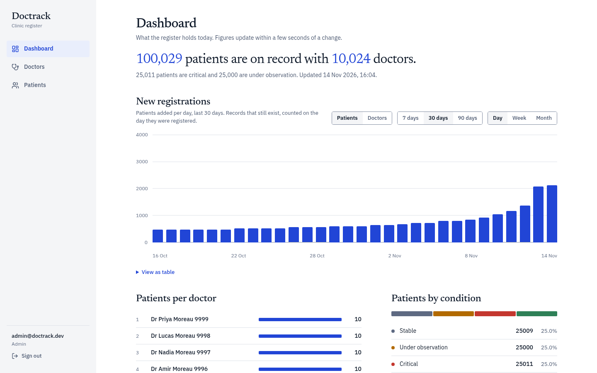
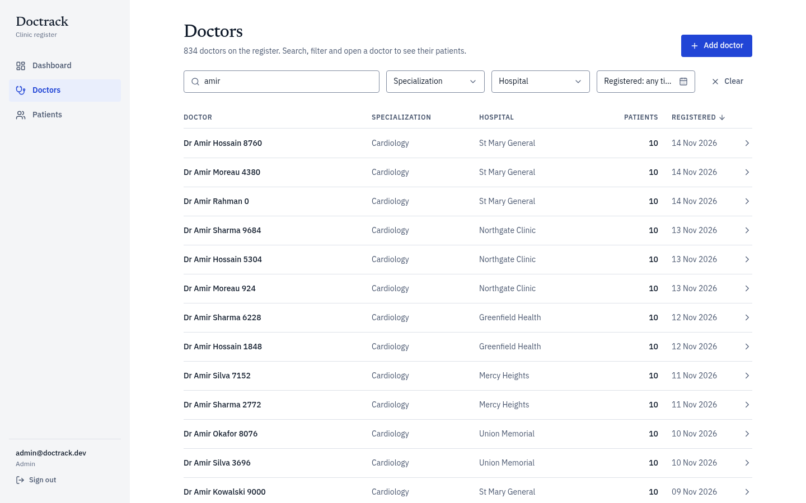
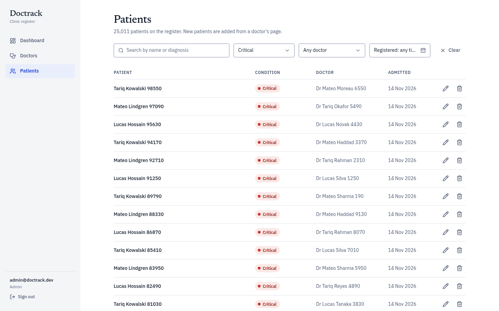
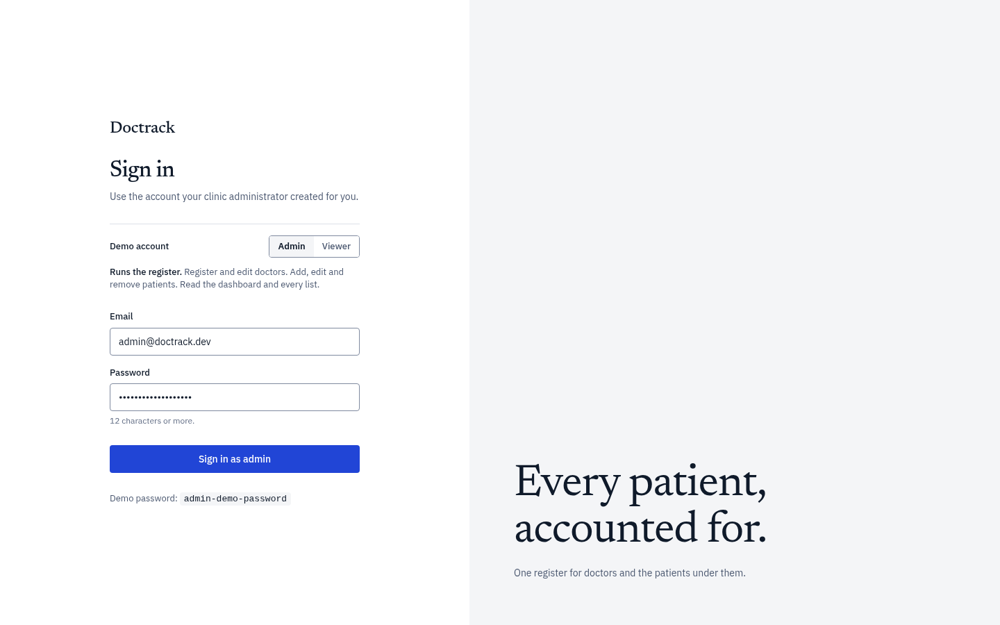
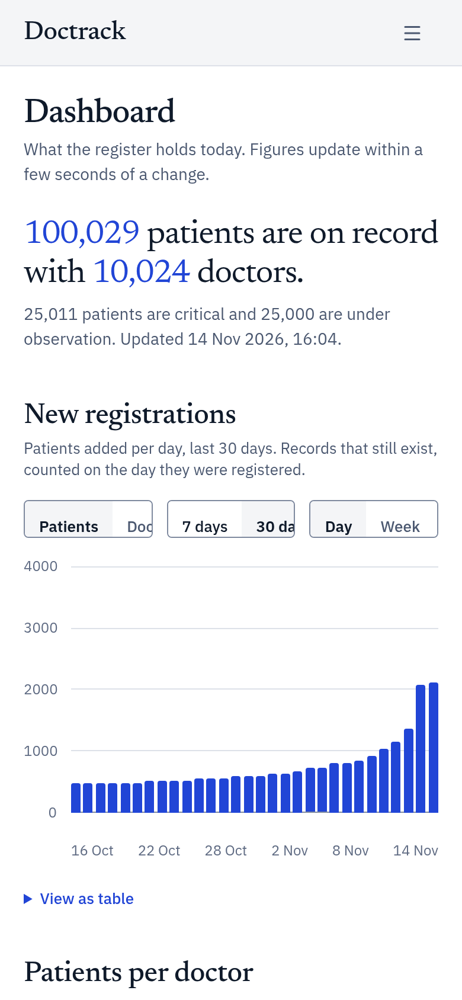
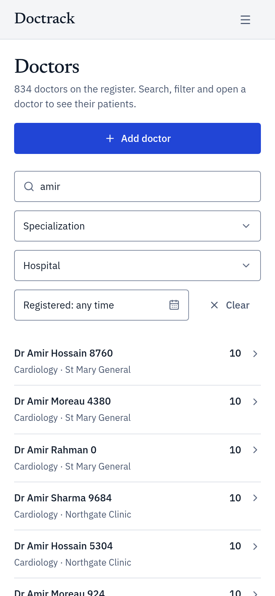
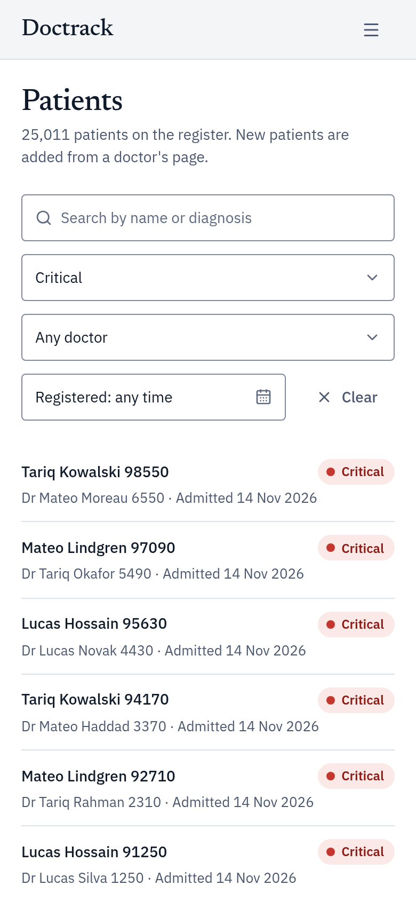
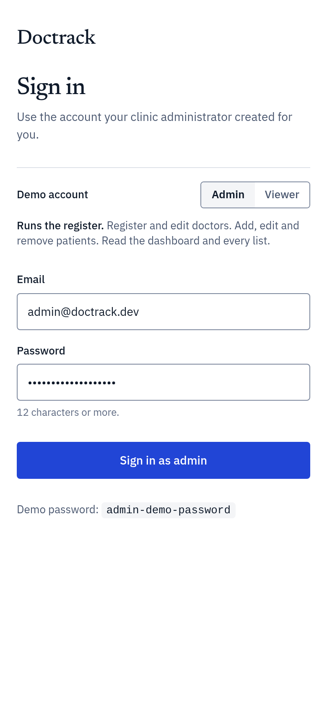

# Doctrack

A register for a medical administration team: doctors, the patients assigned to each, and a dashboard that stays correct while the data changes underneath it. Admins manage records; viewers read them. It is built to stay fast at 10,000 doctors and 100,000 patients.

- **Web:** Next.js 16, React 19, TanStack Query, Tailwind v4 (`apps/web`)
- **API:** Express 5 modular monolith on Node 24 (`apps/api`), contract shared with the web through `packages/contracts`
- **Data and messaging:** MongoDB replica set, NATS JetStream, Redis

## Setup guide

Requirements: Docker with Compose, Node 24, pnpm.

```bash
make init       # .env with generated secrets, Mongo keyfile, JWT keypair, dependencies
make up         # mongo, redis, nats, api, worker, web
make seed       # demo accounts plus a working data set: 24 doctors, 320 patients
make seed-scale # optional: 10,000 doctors and 100,000 patients
```

Open <http://localhost:3000>. API documentation (Swagger UI) is served by the API at `/docs`, published on `http://localhost:8080/docs` locally.

| Role   | Email                 | Password               |
| ------ | --------------------- | ---------------------- |
| Admin  | `admin@doctrack.dev`  | `admin-demo-password`  |
| Viewer | `viewer@doctrack.dev` | `viewer-demo-password` |

These are the values in `.env.example`. With `DEMO_MODE=true` the sign-in screen offers both accounts as a role switch that fills the form. Set `DEMO_MODE=false` and change the passwords before exposing a real instance.

### Environment

`make init` copies `.env.example` to `.env` and replaces the three infrastructure passwords with random values.

```dotenv
NODE_ENV=production
LOG_LEVEL=info
TRUST_PROXY_HOPS=1

MONGO_ROOT_USER=doctrack
MONGO_ROOT_PASSWORD=change-me
MONGO_DB=doctrack

REDIS_PASSWORD=change-me

NATS_USER=doctrack
NATS_PASSWORD=change-me

API_HOST_PORT=8080
WEB_HOST_PORT=3000

DOMAIN=doctrack.example.com
COOKIE_SECURE=false
DEMO_MODE=true
ACCESS_TOKEN_TTL_S=900
REFRESH_TOKEN_TTL_S=604800

SEED_ADMIN_EMAIL=admin@doctrack.dev
SEED_ADMIN_PASSWORD=admin-demo-password
SEED_VIEWER_EMAIL=viewer@doctrack.dev
SEED_VIEWER_PASSWORD=viewer-demo-password
```

### Commands

| Command                  | Does                                                                           |
| ------------------------ | ------------------------------------------------------------------------------ |
| `make check`             | lint, format, typecheck, architecture rules, unit tests, build                 |
| `make test-integration`  | tests against real MongoDB, Redis and NATS                                     |
| `make test-e2e`          | Playwright journeys at 390 and 1440 px, with axe accessibility checks          |
| `make explain-check`     | `explain()` on the hot list queries; fails on any `COLLSCAN`                   |
| `make load-check`        | p95 latency of the list and dashboard endpoints                                |
| `make rebuild-analytics` | recompute the dashboard read model (`ARGS=--check` only verifies)              |
| `make deploy`            | the stack behind Caddy with automatic TLS (set `DOMAIN`, `COOKIE_SECURE=true`) |

## System architecture

```
Browser ──► web (Next.js) ──forwards client IP──► api (Express, internal network only) ──► MongoDB
                │                                   │  ▲                                    ▲
                │                                   │  └── Redis (token blacklist,          │
                │                                   │       rate limits, dashboard cache)   │
                │                          outbox row, same transaction                     │
                │                                   ▼                                       │
                └──────────────────────────────  worker ──► NATS JetStream ──► consumers ──┘
                                                            (doctor patient counts, dashboard read model, audit log)
```

- `api` and `worker` are one codebase with two entry points, so they share domain code and deploy and scale separately.
- Each module (`identity`, `doctors`, `patients`, `analytics`, `audit`) has `domain`, `application`, `infrastructure` and `presentation` layers and exposes only its `index.ts`. `make check` fails the build on a forbidden import.
- Writes run as commands inside a Mongo transaction that also writes the events to an outbox collection. The worker relays them to JetStream, and idempotent consumers keep derived data (a doctor's patient count, the dashboard, the audit log) up to date.
- Reads are queries over indexed collections or the dashboard read model. They never load aggregates.
- The browser only ever talks to the web app. It proxies `/api/v1` to the API, which is not reachable from outside the Docker network.

More detail is in `.project-doc/docs/ARCHITECTURE.md`, `DATA_MODEL.md` and `API_CONTRACT.md`.

## Technical decisions

### 1. Transactional outbox in front of JetStream

A patient is added and a dashboard has to change, a doctor's count has to change, an audit row has to exist. Writing the data and then publishing an event is a dual write: a crash between the two loses the event, and the dashboard drifts.

The event is therefore written to an `outbox` collection in the same MongoDB transaction as the data. A relay claims batches with a lease, publishes them to JetStream with `Nats-Msg-Id` set to the event id, and marks them published. Polling is the source of truth and a change stream only wakes it early, so a missed notification costs one poll interval, never an event.

Delivery is at least once, so every consumer records the event ids it has handled (`processed_events`) and does nothing the second time. A message that keeps failing goes to a dead-letter subject after `max_deliver`. Integration tests cover the failure cases: the same event published twice has one effect, killing the relay between publish and mark has one effect, two relays never publish the same row, and a failing handler reaches the dead-letter queue.

What it costs: the dashboard is eventually consistent, typically within a second. The page says so ("Figures update within a few seconds of a change"), and `make rebuild-analytics --check` verifies the read model against the source data at any time.

### 2. Sessions that can be revoked, and limits that cannot be walked around

Short-lived ES256 tokens are stateless, which makes logging out meaningless unless something remembers. On logout the token's id is written to Redis with a TTL equal to its remaining life, so the blacklist never grows past the number of live tokens, and a replayed token returns `TOKEN_REVOKED`. Refresh tokens rotate, and reuse of an old one revokes the whole family. Redis is a hard dependency by choice: if it is down the API answers `503 UNAVAILABLE` rather than skipping the revocation check.

Rate limiting is per endpoint and per user, with a global per-IP limit in front of authentication. Failed logins count against the client IP and the account together, so an attacker cannot lock a real user out from another address. Responses carry the IETF `RateLimit-Policy` and `RateLimit` headers and a `Retry-After` on `429`, and the UI shows the wait.

All of this depends on knowing the client's real address. The browser reaches only the web app, which takes the last `X-Forwarded-For` entry (the one the edge proxy appended) and sends exactly one value to the API, which trusts exactly one proxy hop. A forged leading entry changes nothing; a unit test covers it.

## Performance

Measured with 10,024 doctors and 100,029 patients on a development machine (`make explain-check`, `make load-check`).

| Target                                                                             | Result                         |
| ---------------------------------------------------------------------------------- | ------------------------------ |
| p95 of `GET /doctors` and `/patients` with search, filter and paging, under 300 ms | 5 to 37 ms, deepest page 37 ms |
| p95 of every `/dashboard/*` endpoint, under 200 ms                                 | 3 to 4 ms                      |
| Hot queries using `COLLSCAN`                                                       | 0 of 13                        |
| Lighthouse accessibility, main pages                                               | 100                            |

## Visual evidence

Desktop (1440 px)






Mobile (390 px)

   

## Repository layout

```
apps/api            Express API and the worker (modules, platform, scripts)
apps/web            Next.js application
packages/contracts  Zod schemas shared by the API, its OpenAPI document and the web app
infra               Mongo keyfile and replica set initialisation, Caddy configuration
.project-doc        Requirements, architecture, decisions, plan and status
```
